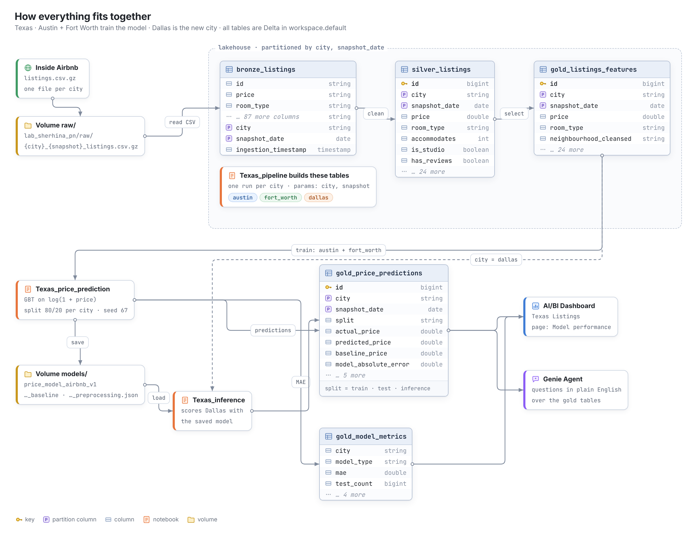
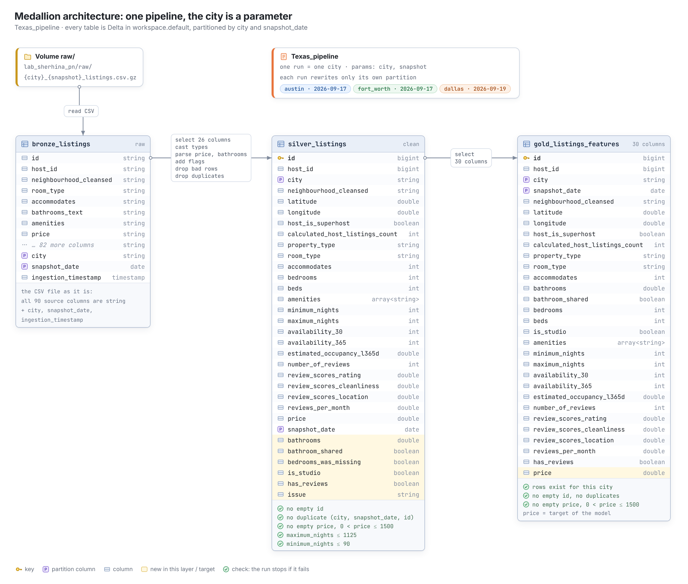
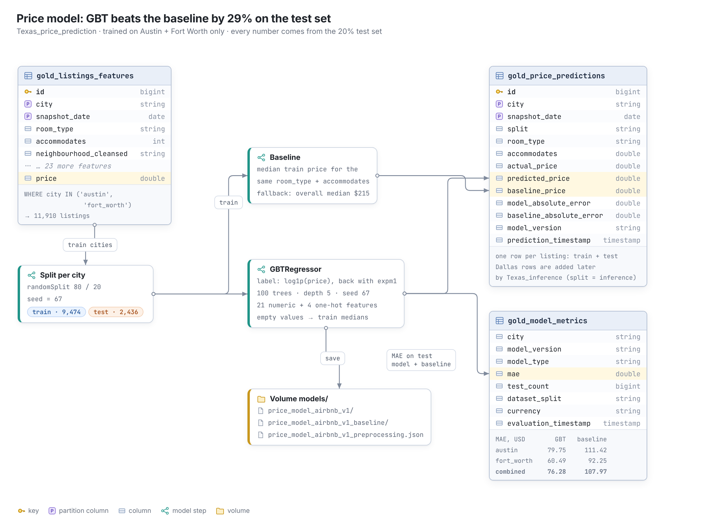

# 🏠 Short-term rental analytics: Texas

We build a **lakehouse** over Airbnb data, a **price model**, a **dashboard** and a **Genie Agent**.
We train on two Texas cities. Then we test the same pipeline and model on a third city that the model never saw.

> **The main result:** the model works in a new city, but it is less helpful there.
> In Dallas it beats the baseline by **13%**. In the training cities it beats the baseline by **29%**.

---

## 📍 Region and cities

| | City | Role | Snapshot date | Listings in the file | Listings after cleaning |
|---|---|---|---|---:|---:|
| 🅰️ | **Austin** | training city (A) | 2026-09-17 | 13,542 (A + B) | 9,759 |
| 🅱️ | **Fort Worth** | training city (B) | 2026-09-17 | *(together with Austin)* | 2,151 |
| 🆕 | **Dallas** | new client (C) | 2026-09-19 | 6,436 | 5,913 |

- **Region:** Texas, USA. All prices are in **USD**.
- **Data:** [Inside Airbnb](https://insideairbnb.com/get-the-data/), file `listings.csv.gz` (detailed listings), licence CC BY 4.0.
- **Why Dallas is city C:** Dallas is a big city in the same region and it is next to Fort Worth. So it is a fair test: the market is similar, but the model has never seen its listings and its neighbourhoods.

---

## 🗂️ Repository

```
.
├── README.md
├── images/                           diagrams for this README
└── notebooks/
    ├── Texas_exploratory.ipynb       1. Exploratory analysis of Austin and Fort Worth
    ├── Texas_pipeline.ipynb          2. ETL pipeline: bronze → silver → gold, one city per run
    ├── Texas_price_prediction.ipynb  3. Price model: training, test, baseline, predictions
    └── Texas_inference.ipynb         4. City C: Dallas predictions with the saved model
```

📊 **Presentation:** [`link`](https://canva.link/gzol5t3l0wfxhn6)

---

## 🔄 How everything fits together



---

## 1️⃣ Exploratory analysis: size sets the price, ratings do not

Notebook: [`Texas_exploratory.ipynb`](notebooks/Texas_exploratory.ipynb)

**One row** = one Airbnb listing in one city on the snapshot date. The file has 92 columns. We keep 26 of them.

### What we know

| Finding | Numbers |
|---|---|
| 📏 **Size is the strongest driver of price.** The link is not a straight line, so Spearman is higher than Pearson. | `accommodates`: Spearman 0.66, Pearson 0.58<br/>`bedrooms`: Spearman 0.60, Pearson 0.54 |
| ⭐ **Ratings do not change the price.** Almost all listings have 4.5–5.0 stars. | `review_scores_rating`: Spearman 0.10, Pearson 0.01 |
| 📈 **Price has a long right tail.** The mean is not a good summary, so we use the median. | mean $333, median $215, std $742 |
| 🕳️ **Empty values have a pattern.** They are not random. | see the table below |

| Column | Empty | Why | What the pipeline does |
|---|---:|---|---|
| `review_scores_*`, `reviews_per_month` | 17% | the listing has no reviews yet | keep empty, add `has_reviews` |
| `bedrooms` | 0.3% | only in entire homes: these are studios | write 0, add `is_studio` |
| `neighbourhood_cleansed` | 9% | only in Fort Worth (about half of its listings) | write `"Unknown - Fort Worth"` |
| `price` | 10% | no price in the snapshot | remove the row (it is the target) |

### Outliers: we classify them, we do not just delete them

Z-score does not work here: the luxury listings make the standard deviation too big. The median and MAD work better. Each row gets one label:

| Label | Rule | Reason |
|---|---|---|
| `impossible_price` | price ≤ 0 or > $1,500 | not a normal short-term rental price |
| `impossible_max_nights` | `maximum_nights` > 1,125 | above the Airbnb limit |
| `long_term` | `minimum_nights` > 90 | a long lease, not a short-term rental |
| `ok` | everything else | used for the model |

### 🚫 Leakage: columns we must not use

- `price_quote_total_price`, `price_quote_price_per_night`, `price_quote_raw`: they are calculated from the price.
- `estimated_revenue_l365d` is also calculated from the price (price × booked nights). It is not in the 26 columns, so it never reaches the model.

### What we still do not know

- How much the location (downtown or not) adds to the price.
- If big hosts (50+ listings) set prices in another way than small hosts.
- How prices change during the year: we have only one snapshot.

---

## 2️⃣ Architecture and ETL: one pipeline, the city is a parameter

Notebook: [`Texas_pipeline.ipynb`](notebooks/Texas_pipeline.ipynb)

We use the **medallion architecture**. Every layer is a Delta table, partitioned by `city` and `snapshot_date`.



| Layer | Table | One row is | What happens here |
|---|---|---|---|
| 🥉 **Bronze** | `bronze_listings` | one listing, raw text | The CSV file as it is: all columns are `string`. We add `city`, `snapshot_date`, `ingestion_timestamp`. |
| 🥈 **Silver** | `silver_listings` | one clean listing | 26 columns, correct types, `price` as a number, `bathrooms_text` → `bathrooms` + `bathroom_shared`, flags `is_studio` and `has_reviews`, bad rows and duplicates removed. |
| 🥇 **Gold** | `gold_listings_features` | one listing, ready for the model | 30 columns for the model, the dashboard and Genie. |
| 🥇 **Gold** | `gold_price_predictions` | one listing with its prediction | actual price, model price, baseline price, errors, `split` (train / test / inference). |
| 🥇 **Gold** | `gold_model_metrics` | one MAE value | MAE of the model and the baseline per city and for both cities together. |

**Why it works for a new city:**

- The city and the snapshot date are **parameters** (`dbutils.widgets`). The code is the same for every city.
- Each run **overwrites only its own partition** (`partitionOverwriteMode = dynamic`). Austin does not delete Fort Worth, and running a city again does not make duplicates.
- **Checks after every layer:** no empty IDs, no duplicates, no empty or impossible prices, no impossible nights. If a check fails, the run stops (`assert`).

**How to run:** open `Texas_pipeline`, set `city` (for example `austin`) and `snapshot` (for example `2026-09-17`), then **Run all**. Do this for each city, or run the notebook from a Databricks Job.

---

## 3️⃣ Price model: 29% better than the baseline

Notebook: [`Texas_price_prediction.ipynb`](notebooks/Texas_price_prediction.ipynb)



| | |
|---|---|
| **Target** | `price`: price per night in USD on the snapshot date. We train on `log1p(price)` because of the long tail, then we turn the prediction back into USD. |
| **Model** | Gradient-Boosted Trees (`pyspark.ml`, 100 trees, depth 5). |
| **Features** | 21 numbers (size, location, host, availability, reviews, flags) + 4 categories (`city`, `neighbourhood_cleansed`, `property_type`, `room_type`). |
| **Baseline** | The median training price for the same `room_type` and `accommodates`. |
| **Fair test** | We split the data **before** anything else. Medians for empty values and the baseline come only from the train set. All numbers below come from the test set. |

### Results on the test set (MAE, USD, lower is better)

| City | Baseline | Model | Model is better by |
|---|---:|---:|---:|
| Austin | $111.42 | **$79.75** | 28% |
| Fort Worth | $92.25 | **$60.49** | 34% |
| **Both cities** | $107.97 | **$76.28** | **29%** |

The model and its helper data (medians, baseline table) are saved to the volume `/Volumes/workspace/default/models`. So the inference notebook can use the model without training it again.

---

## 4️⃣ New client, Dallas: the model still wins, but by less

Notebook: [`Texas_inference.ipynb`](notebooks/Texas_inference.ipynb)

We ran the **same pipeline** with `city = dallas`, then the **saved model** on all 5,913 Dallas listings. The model never saw Dallas.

### The three numbers

| | MAE (USD) |
|---|---:|
| Baseline on Dallas | $94.40 |
| Model on Austin + Fort Worth (test set) | $76.28 |
| **Model on Dallas** | **$82.34** |

| | Baseline | Model | Model is better by |
|---|---:|---:|---:|
| Austin + Fort Worth (test set) | $107.97 | $76.28 | 🟩🟩🟩🟩🟩🟩 **29%** |
| Dallas (new city) | $94.40 | $82.34 | 🟩🟩🟩 **13%** |

### Why the gap

- 🗺️ **New neighbourhoods.** The model learned prices for Austin and Fort Worth neighbourhoods. All Dallas neighbourhoods are new to it, so this feature does not help.
- 🏙️ **New city.** `city` is a feature, and `dallas` is a value the model never saw.
- 💎 **Luxury listings.** The biggest errors are listings above $1,000 a night: the model predicts too low. There are few such listings in the training data.
- ✅ **But the error is still close.** $82 in Dallas against $80 in Austin: what the model learned about size, rooms and reviews also works in a new Texas city.

### What we changed for Dallas

> *Fill in: for every change, write what broke, what you changed, and why.*

| # | Change | Kind | Why |
|---|---|---|---|
| 1 | | pipeline fix / model change | |
| 2 | | pipeline fix / model change | |

---

## 5️⃣ Dashboard and Genie

- **AI/BI Dashboard "Texas Listings":** built on the gold tables. The **Model performance** page shows the predictions from `gold_price_predictions`, also for Dallas (`split = 'inference'`). *Add the other pages here.*
- **Genie Agent:** answers questions about the gold tables, for example:
  - *"What is the median price of entire homes in Austin?"*
  - *"Which neighbourhoods in Fort Worth have the most listings?"*
  - *"Where does the model under-price listings the most?"*

> *Add links or screenshots here.*

---

## ▶️ How to reproduce

All work runs on **Databricks Free Edition** and costs nothing.

1. Import the notebooks from `notebooks/` into Databricks.
2. Run `Texas_exploratory` to see the analysis.
3. Run `Texas_pipeline` three times: `austin` / `2026-09-17`, `fort_worth` / `2026-09-17`, `dallas` / `2026-09-19`.
4. Run `Texas_price_prediction`. It trains on Austin and Fort Worth only and saves the model.
5. Run `Texas_inference` to score Dallas.

---

## 👥 Team

| Name | Main work |
|---|---|
| *Oleksandra Shergina* | ETL Pipeline, Price Model, Genie Agent |
| *Viktoriia Lushpak* | EDA, Dashboard, New client |
| *name* | *work* |
